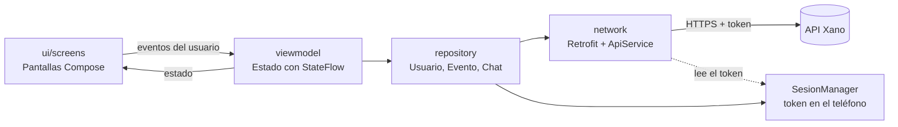

# Mygos

App Android para encontrar eventos gamer (torneos, LAN, lanzamientos y juntas casuales) y no ir solo: al inscribirte entras al chat del evento con los demás participantes.

## Funcionalidades

- Crear cuenta e iniciar sesión con validaciones. La sesión queda guardada en el teléfono, así que al volver a abrir la app se entra directo a los eventos.
- Lista de eventos con buscador (sin importar tildes) y filtros por tipo.
- Detalle del evento, inscripción y lista de participantes.
- Chat grupal de cada evento con los inscritos y el organizador.
- Publicar evento con formulario validado, foto del lugar (cámara) y ubicación (GPS y mapa).
- Perfil con eventos inscritos y cierre de sesión con confirmación.
- Avisos en pantalla cuando no hay internet o la API responde con error.

## Tecnologías

| Área | Tecnología |
|---|---|
| Lenguaje y UI | Kotlin, Jetpack Compose y Material 3 |
| Arquitectura | MVVM con repositorios |
| Navegación | Navigation Compose |
| Backend | API REST en [Xano](https://www.xano.com/) |
| Cliente HTTP | Retrofit 3 + Gson + OkHttp |
| Sesión local | SharedPreferences (`SesionManager`) |
| Asincronía | Corrutinas y `StateFlow` |
| Hardware | Cámara (`TakePicture` + `FileProvider`), GPS (`LocationManager`) |
| Mapa | Google Maps (`maps-compose`) |
| Pruebas | JUnit 4 |

Requisitos: Android 7.0 (API 24) o superior. Se compila con `compileSdk` y `targetSdk` 37.

## Arquitectura

La app sigue el patrón **MVVM**. Cada pantalla tiene su ViewModel, el ViewModel pide los datos a un repositorio y el repositorio llama a la API de Xano.



### Flujo de una pantalla

1. La pantalla (Compose) muestra el estado que expone su ViewModel con `StateFlow`.
2. Cuando el usuario hace algo (por ejemplo, inscribirse), la pantalla llama a una función del ViewModel.
3. El ViewModel lanza una corrutina y le pide los datos al repositorio.
4. El repositorio llama a la API con Retrofit y convierte la respuesta (DTO) en un modelo de la app.
5. El ViewModel actualiza el estado y la pantalla se vuelve a dibujar sola.

### Estructura de carpetas

```
app/src/main/java/com/example/caso_notaria/
├── MainActivity.kt        Punto de entrada, aplica el tema y la navegación
├── model/                 Modelos de la app (Evento, Usuario, Mensaje, Inscripcion) y validaciones de formularios
├── network/               Conexión con Xano
│   ├── ApiService.kt      Endpoints de la API
│   ├── Dtos.kt            Objetos que se envían y reciben, y su conversión a modelos
│   ├── RetrofitClient.kt  Crea Retrofit y agrega el token a cada llamada
│   └── ErroresApi.kt      Manejo de errores y mensajes para el usuario
├── repository/            Fuente de datos para los ViewModels
│   ├── UsuarioRepository  Inicio de sesión, registro y sesión guardada
│   ├── EventoRepository   Eventos, inscripciones y participantes
│   ├── ChatRepository     Mensajes y lista de chats del usuario
│   └── SesionManager      Guarda el token y los datos del usuario en el teléfono
├── viewmodel/             Un ViewModel por pantalla con su estado
├── navigation/            Rutas (Screen), eventos de navegación y NavHost
└── ui/
    ├── screens/           Pantallas de la app
    ├── components/        Componentes reutilizables (botones, tarjetas, mapa, cámara, barra inferior)
    └── theme/             Colores, tipografía y tema oscuro
```

### Navegación

Al abrir la app, `MainViewModel` revisa si hay una sesión guardada:

- **Con sesión:** entra directo a **Eventos**.
- **Sin sesión:** parte en **Bienvenida**, desde donde se va a **Iniciar sesión** o **Crear cuenta**.

Ya dentro, la barra inferior tiene cuatro pestañas: **Eventos**, **Publicar**, **Chats** y **Perfil**. Desde un evento se puede abrir su **Detalle**, sus **Participantes** y su **Chat**. Estas rutas llevan el id del evento (por ejemplo, `detalle_evento/{eventoId}`).

### Sesión y autenticación

1. Al iniciar sesión o crear cuenta, Xano devuelve un `authToken`.
2. La app pide los datos del usuario con ese token (`/auth/me`) y guarda ambos en el teléfono con `SesionManager` (SharedPreferences).
3. `RetrofitClient` agrega el encabezado `Authorization: Bearer <token>` a todas las llamadas.
4. Al cerrar sesión se borran los datos guardados.

### Manejo de errores

Las llamadas a la API se envuelven en `llamarApi`, que devuelve un `Result`. Según el error, el usuario ve un mensaje distinto:

| Caso | Mensaje |
|---|---|
| Sin internet | "Sin conexión. Revisa tu internet e intenta de nuevo." |
| Token vencido (401) | "Tu sesión expiró. Cierra sesión y vuelve a entrar." |
| Otro error | "No pudimos cargar los datos. Intenta de nuevo." |

Cuando Xano responde con un error que trae mensaje (400, 403 o 404), se muestra ese mensaje. Por ejemplo, al inscribirse en un evento sin cupos.

## API (Xano)

URL base: `https://x8ki-letl-twmt.n7.xano.io/`

La API está dividida en dos grupos:

- **Autenticación:** `/api:tjA5KM8v`
- **Mygos (eventos, inscripciones y chat):** `/api:I-2YImHk`

Las rutas que piden sesión usan el token en el encabezado `Authorization: Bearer <token>`.

### Autenticación

| Método | Endpoint | Qué hace | Envía | Responde |
|---|---|---|---|---|
| POST | `/auth/signup` | Crea una cuenta | `name`, `email`, `password`, `nivel`, `juego_preferido`, `plataforma` | `authToken`, `user_id` |
| POST | `/auth/login` | Inicia sesión | `email`, `password` | `authToken`, `user_id` |
| GET | `/auth/me` | Datos del usuario conectado | Token | Usuario |

Si el correo ya existe (registro) o la contraseña es incorrecta (login), Xano responde **403**.

### Eventos

| Método | Endpoint | Qué hace | Envía | Responde |
|---|---|---|---|---|
| GET | `/eventos` | Lista todos los eventos | — | Lista de eventos |
| GET | `/eventos/{eventoId}` | Detalle de un evento | — | Evento (404 si no existe) |
| POST | `/eventos` | Publica un evento. El organizador es el usuario del token | Datos del evento | Evento creado |

### Inscripciones

| Método | Endpoint | Qué hace | Envía | Responde |
|---|---|---|---|---|
| GET | `/inscripciones` | Lista todas las inscripciones (sirve para contar cupos) | — | Lista de inscripciones |
| POST | `/eventos/{eventoId}/inscripciones` | Inscribe al usuario del token | Token | Inscripción |
| GET | `/eventos/{eventoId}/participantes` | Participantes de un evento | — | Lista de participantes |

### Chat

| Método | Endpoint | Qué hace | Envía | Responde |
|---|---|---|---|---|
| GET | `/eventos/{eventoId}/mensajes` | Mensajes del chat del evento | — | Lista de mensajes |
| POST | `/eventos/{eventoId}/mensajes` | Envía un mensaje | `texto` | Mensaje creado |

Los mensajes con `autor_id = 0` son avisos automáticos del chat.

### Modelos de datos

**Usuario**

| Campo | Tipo | Descripción |
|---|---|---|
| `id` | int | Identificador |
| `name` | text | Alias del jugador |
| `email` | text | Correo (no se muestra a otros jugadores) |
| `nivel` | text | Casual, Intermedio o Competitivo |
| `juego_preferido` | text | Juego favorito |
| `plataforma` | text | PC, Consola o Mixta |

**Evento**

| Campo | Tipo | Descripción |
|---|---|---|
| `id` | int | Identificador |
| `nombre` | text | Nombre del evento |
| `tipo` | text | Torneo, LAN, Lanzamiento o Casual |
| `juego` | text | Juego del evento |
| `formato` | text | Formato de juego |
| `plataforma` | text | Plataforma |
| `fecha` / `hora` | text | Fecha y hora del evento |
| `modalidad` | text | Presencial u Online |
| `lugar` | text | Dirección (solo si es presencial) |
| `latitud` / `longitud` | decimal | Ubicación en el mapa (opcional) |
| `foto_uri` | text | Foto del lugar (opcional) |
| `cupos` | int | Entre 2 y 500 |
| `descripcion` | text | Descripción del evento |
| `organizador_id` | int | Usuario que lo publicó |
| `organizador_alias` | text | Alias del organizador |

**Inscripción:** `id`, `evento_id`, `usuario_id`.

**Participante:** `usuario_id`, `alias`, `nivel`, `juego_preferido`, `plataforma`.

**Mensaje:** `id`, `created_at` (milisegundos), `evento_id`, `autor_id`, `autor_alias`, `texto`.

## Cómo ejecutar

1. Clonar el repositorio y abrirlo en Android Studio.
2. Para ver el mapa, agregar la clave de Google Maps en `local.properties`:

   ```
   MAPS_API_KEY=tu_clave
   ```

   Sin la clave la app funciona igual, pero el mapa se ve vacío.
3. Ejecutar la configuración `app` en un emulador o teléfono con Android 7.0 o superior y con internet.

### Cuenta de prueba

| Correo | Contraseña |
|---|---|
| prueba@mygos.cl | Mygos2026 |

También se puede crear una cuenta nueva desde la app.

## Pruebas unitarias

Están en `app/src/test` y se ejecutan con clic derecho en la carpeta → **Run 'Tests in ...'**.

- `ValidacionesTest`: alias, correo, contraseña, confirmación y nivel del registro.
- `ValidacionesEventoTest`: nombre, cupos, fecha, lugar, descripción y campos de selección del evento.
- `PublicarEventoViewModelTest`: estado del formulario de publicar evento (errores, evento online, formato de hora y limpiar formulario).

## Equipo

- Carlos Meza
- Felipe Yefi
- Martin Veyl

## Organización

- Tareas en Trello.
- Una rama por tarea (`feature/...`, `fix/...`) y Pull Request hacia `main`.
